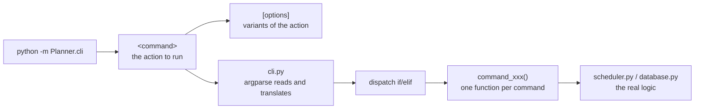
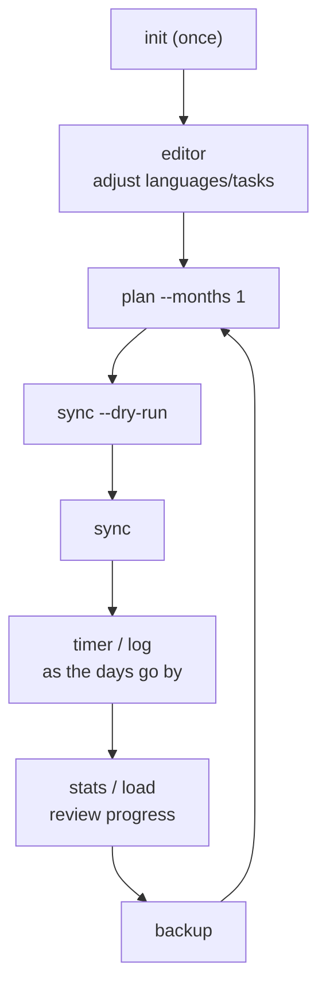

# Language Planner — CLI Commands (Cheat Sheet)

!!! Don't forget to run on venv: \
* **activate**: source .venv/bin/activate
* **run directly**: /path/to/Lanplan/.venv/bin/python -p Planner.cli < command >

## Command syntax

```
python -m Planner.cli  <command>  [options]
```



| Piece | Role |
|---|---|
| `python -m Planner.cli` | runs the `cli.py` module (`-m` makes the package imports valid) |
| `<command>` | the argparse subcommand (`plan`, `sync`…) — required |
| `[options]` | optional: filter or parameterize the action (`--dry-run`, `--weeks N`…) |

Safety reflex: any command that writes outside the project (`sync`) must be tested **first** with `--dry-run`.

## All commands

### Read-only (nothing is written)

| Command | Description |
|---|---|
| `languages` | list languages: id, name, level → objective, status, target minutes/week |
| `tasks` | list tasks: name, duration, min/max quotas per week |
| `check` | SQLite integrity check (`PRAGMA integrity_check`) + languages/tasks overview |
| `load` | cognitive-load report: minutes and languages per day, alerts when guards are exceeded |

### Setup and maintenance

| Command | Options | Description |
|---|---|---|
| `init` | — | create/upgrade the database (idempotent: safe to rerun) |
| `editor` | — | interactive editor: modify languages, tasks, settings |
| `backup` | — | copy the database to `backups/planner-YYYY-MM-DD.sqlite` |

### The planning cycle

| Command | Options | Description |
|---|---|---|
| `plan` | `--months N` | generate the schedule locally (written to the database, nothing is sent). Default: horizon from settings (3 months) |
| `sync` | `--dry-run` | generate **and push to Nextcloud/CalDAV**. Without `--dry-run`: writes for real. Always dry-run first |
| `log` | `--date YYYY-MM-DD` | mark a session done/skipped + quality 0–5 (default: today) |
| `timer` | `--date YYYY-MM-DD` | run a live-timed session (`start`/`stop`), records the **real minutes** |

### Reporting

| Command | Options | Description |
|---|---|---|
| `stats` | `--weeks N`, `--html path.html` | weekly report, planned vs actual. `--html` writes a standalone dashboard (Chart.js) |
| `load` | `--weeks N` | limit the load report to the last N weeks </br> necessary if you change some settings|

### Extensions

| Command | Options | Description |
|---|---|---|
| `anki` | `run`, `quotas`, `set`, `add`, `remove` | the day's Anki routine (aligned with the planner). E.g. `anki run --dry-run`, `anki quotas` |
| `web` | `--host`, `--port N`, `--debug` | launch the Flask GUI (default: `127.0.0.1:5000`) |

## Reading the options

| Argparse pattern | Behavior |
|---|---|
| `--dry-run` (`store_true`) | boolean: present → True, absent → False |
| `--weeks N` (`type=int`) | required value, converted to an integer |
| `--date YYYY-MM-DD` | free string, default `None` (= today in the code) |
| `anki_args` (`REMAINDER`) | swallows the rest of the line and passes it to the `anki` module |

## Typical usage order

